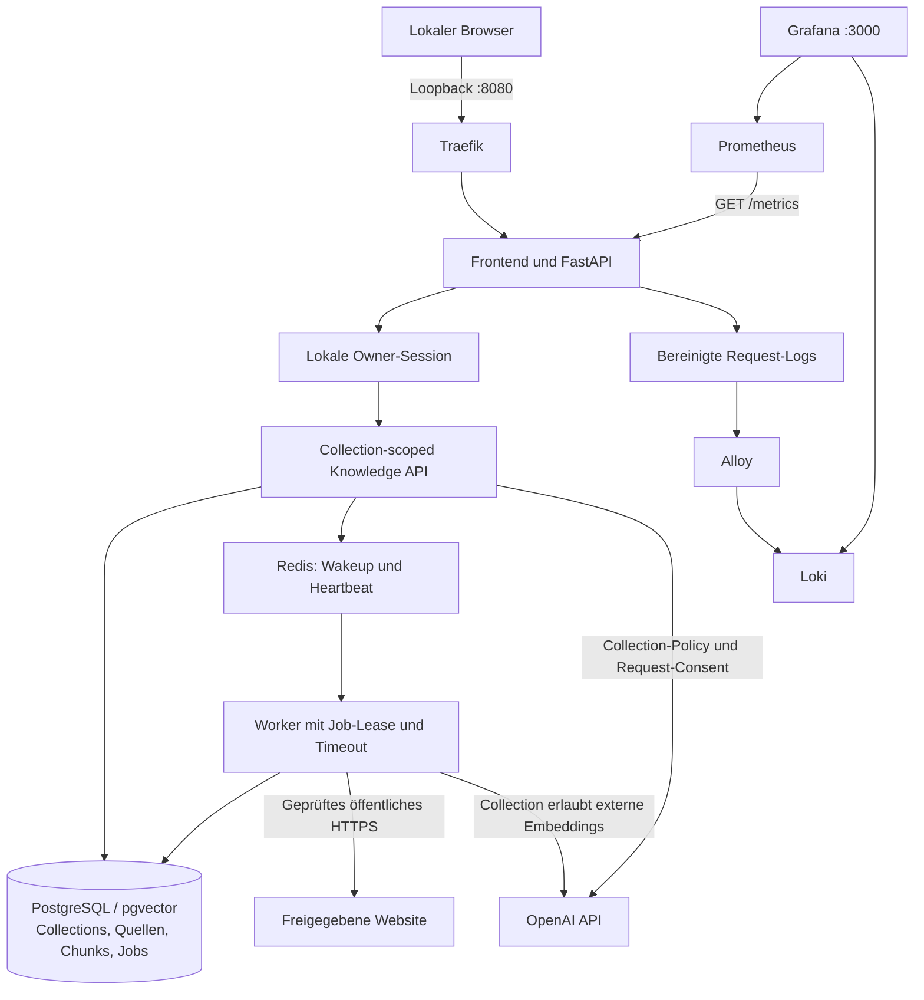
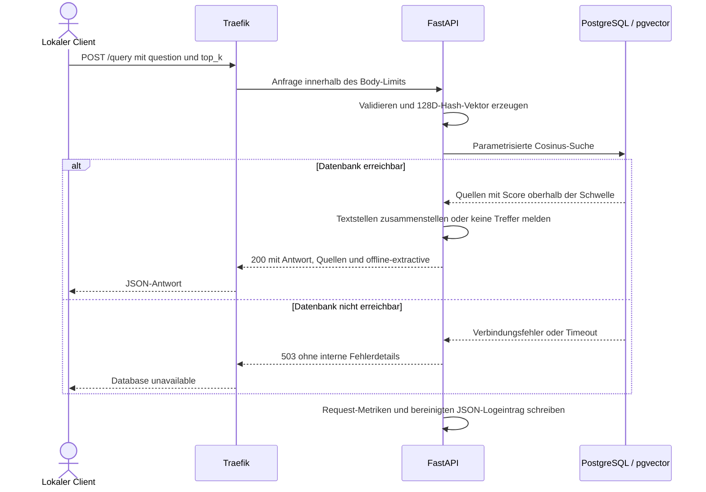

# Architektur

## Lokale Laufzeit

UI und API werden als ein Image unter derselben Origin ausgeliefert. Statische
Assets liegen unter `apps/demo-rag/frontend/`; Modellschlüssel gehen nur an API
und Worker. Die Knowledge-Endpunkte erfordern eine lokale Owner-Session.
Collections legen Suchraum, Embedding-Methode und externe Verarbeitung fest.
Die neue Architektur ist in [KNOWLEDGE-WORKSPACE.md](KNOWLEDGE-WORKSPACE.md) erklärt.

Die Netzwerkgruppen zeigen die logischen Grenzen. Die API verbindet Edge-,
Backend- und Telemetrie-Netz; Grafana und Prometheus besitzen zusätzlich ein
Management-Netz für die veröffentlichten Loopback-Ports. Loki und die DB
veröffentlichen keine Host-Ports. Der [Restore-Pfad](DISASTER-RECOVERY.md)
läuft separat ohne Netzwerk.

Compose verwendet einen festen, projektspezifischen Namen und eigene Volumes.
Nur Traefik, Grafana und Prometheus werden an Loopback gebunden. DB und Loki
haben keine Host-Ports. Traefik verwendet den File-Provider ohne Docker-Socket.
Die Readiness überprüft die Datenbank bei jedem Aufruf; Liveness ist DB-unabhängig.
Startup-Abhängigkeiten ersetzen keine Fehlerbehandlung während des Betriebs.

## Knowledge-Datenfluss

`/api/collections` verwaltet getrennte Suchbereiche. Website-, Text- und
Dateiquellen erzeugen persistente PostgreSQL-Jobs. Ein Worker beansprucht Jobs
mit `FOR UPDATE SKIP LOCKED`, verarbeitet sie in einem begrenzten Kindprozess
und schreibt alle Chunks atomar. Redis ist eine Wakeup-Optimierung; ein Ausfall
verliert keine persistierten Jobs. Originaldateien bleiben als bytea in der DB.

`/api/chat` filtert Chunks vor dem Ranking nach genau einer Collection. Modell,
Provider und Dimensionen sind je Collection festgelegt. Local-only-Policy und
Request-Consent werden vor externen Aufrufen geprüft. Antworten enthalten die
gefundenen Passagen mit Quellreferenz und ggf. PDF-Seite oder URL. Dies ist keine
automatische Verifikation, dass eine Modellantwort die Quellen korrekt wiedergibt.

## Legacy-Demo: Datenfluss und API-Vertrag

`POST /documents` nimmt einen Titel und einen begrenzten Text auf. Eine stabile
SHA-256-basierte Tokenprojektion erzeugt einen normalisierten 128D-Vektor.
PostgreSQL speichert Inhalt und Vektor in einer Transaktion. Identische
Titel-/Inhaltspaare sind idempotent. `POST /query` verwendet pgvector-Cosinusdistanz
und gibt maximal fünf Quellen mit extraktiver Antwort zurück. Negative/irrelevante
Treffer unterhalb der Schwelle liefern keine erfundene Antwort. Hash-Kollisionen
und fehlende Sprachsemantik bleiben Grenzen des Demomodus. Quellen sind Daten,
keine Tool-Instruktionen. Es wird kein externer Provider aufgerufen.

`GET /health/live`: Prozess lebt. `GET /health/ready`: DB-Abfrage erfolgreich,
sonst 503. `GET /metrics`: Prometheus-Format, interne Nutzung. Eine eigene
Scrape-Abfrage aktualisiert die DB-Gauge auch ohne Nutzlast. Query-Inhalte,
Credentials und rohe URLs erscheinen weder als Labels noch in Request-Logs.
Unbekannte Pfade erhalten das feste Label `unmatched`.

## Legacy-Demo: Ablauf einer Retrieval-Anfrage

Das Diagramm zeigt den gültigen Anfragepfad sowie DB-Fehler. Ungültige Eingaben
enden mit 422; zu große Request-Bodies weist der Proxy mit 413 ab. Es gibt
keinen externen Modellaufruf. Metriken und Request-Logs entstehen auch bei Fehlern.

## Entscheidungen

- Python/FastAPI, synchrone psycopg-Verbindungen pro Request: bewusst einfach,
  mit Verbindungs- und Statement-Timeouts; Pooling erst nach Lastnachweis.
- PostgreSQL 16 + pgvector: ein Datenservice, exakte Suche für den kleinen Korpus.
- Schema/Extension beim ersten DB-Start; Seed als explizites Demo-Kommando.
  Die additive Migration `002-knowledge.sql` wird beim Deployment explizit angewandt.
- Lokales HTTP an Loopback. Kein produktives TLS/Auth-Versprechen.
- API non-root, read-only Root-FS, Capabilities entfernt, Ressourcen begrenzt.
  Die Legacy-Tabelle erlaubt der App nur SELECT/INSERT. Neue KB-Tabellen erlauben
  gezieltes CRUD; DDL bleibt bei der Bootstrap-Rolle. Es gibt keine DB-RLS.
- Loki erfasst API-Request-Logs über ein gemeinsames Log-Volume, nicht über
  Hostzugriff. Kurze lokale Retention, keine zentrale Archivgarantie.
- Restore bekommt weder App-Netzwerk noch produktive Volumes oder Zugangsdaten.
- Lockfile und exportierte Python-Abhängigkeiten; feste Image-Tags. Digest-
  Pinning und vollständige Supply-Chain-Verifikation bleiben M4.

## Grenzen

Ein Host, eine DB, keine Hochverfügbarkeit oder Mandantentrennung. Die lokale
Owner-Session ist keine Mehrbenutzer-Authentifizierung. Keine geschätzten
Kosten oder behaupteten Credit-Balances; API-Tokens werden aus Antworten erfasst.
Optional distributed tracing is now locally qualified; see the
[tracing guide](../observability/tempo/README.md). Local semantic retrieval and CPU generation now have synthetic evidence through
[B02/B05](LOCAL-MODELS.md); production relevance and human-reviewed answer quality
remain unverified. DB-Restart kann
Requests scheitern lassen. Telemetrie liegt auf demselben Ausfallbereich und ist
kein externer Alarmkanal. Verfügbarkeit und Ressourcen reichen nur für die lokale
Demo; Last-/Kapazitätsgrenzen werden nicht behauptet.

## Dokumentationsgrundlagen

- [FastAPI lifespan und Tests](https://fastapi.tiangolo.com/advanced/testing-events/)
- [pgvector SQL und Cosinusdistanz](https://github.com/pgvector/pgvector)
- [Compose Startreihenfolge](https://docs.docker.com/compose/how-tos/startup-order/)
- [Traefik File-Provider](https://doc.traefik.io/traefik/reference/install-configuration/providers/others/file/)
- [Grafana Provisioning](https://grafana.com/docs/grafana/latest/administration/provisioning/)
- [Prometheus Konfiguration](https://prometheus.io/docs/prometheus/latest/configuration/configuration/)
- [Alloy Dateilog-Quelle](https://grafana.com/docs/alloy/latest/reference/components/loki/loki.source.file/)
- [Fernet authentifizierte Verschlüsselung](https://cryptography.io/en/latest/fernet/)
