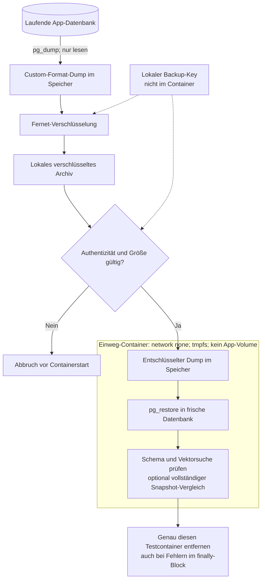

# Backup und Disaster Recovery

## Sicherung und isolierte Wiederherstellung

Der Schlüssel bleibt beim Host-Skript. Der Restore-Container erhält den Dump
über stdin und besitzt keinen Pfad zur laufenden App-Datenbank. Die Prüfung
belegt die logische Wiederherstellung; Offsite-Speicherung und Host-Recovery
bleiben offen.

## Befehle und Grenzen

`make backup` erzeugt einen Custom-Format-pg_dump, authentifiziert verschlüsselt
mit Fernet, unter `.local/backups/`. Der Schlüssel liegt getrennt unter
`.secrets/backup.key` (0600). Beides ist ignoriert. Schlüssel separat sicher
verwahren; ein Backup auf demselben Rechner schützt nicht vor Hostverlust.
Fernet puffert Archive im Speicher: nur kleine Demo-Datenbanken, maximal 64 MiB
Dump. Das ist kein Ersatz für Restic/pgBackRest, Retention, PITR oder Offsite-Speicher.

`make restore-test` wählt das neueste Archiv, prüft Authentizität, startet eine
frische temporäre PostgreSQL/pgvector-Instanz ohne Netzwerk, ohne Host-Port,
ohne produktives Volume und ohne App-Secrets. Nach pg_restore werden Schema,
Dokumentanzahl und eine echte Vektorsuche geprüft. Optional vergleicht
`--expected PATH` alle Dokumente und Vektoren mit einem JSON-Snapshot des Tests.
Der Container wird auch bei Fehlern gezielt entfernt. Ein erfolgreicher Test
belegt nur dieses lokale logische Backup, keine vollständige Host-Recovery.

Das Integrationsszenario schreibt einen eindeutigen Testdatensatz, sichert einen
Snapshot ohne parallele Schreiblast und vergleicht nach dem Restore den gesamten
Dokumentbestand. Schlüsselverlust und manipulierte Archive werden negativ getestet.
Es gibt kein automatisches Überschreiben einer laufenden Datenbank.

RPO/RTO sind noch nicht zugesagt. Für einen Produktionsplan braucht es Backup-
Zeitplan, Retention, Offsite-Ziel, Schlüssel-Escrow, Alarmierung und einen gemessenen
Restore auf frischem Host. Siehe M4 in der [Roadmap](ROADMAP.md).

## Knowledge-Workspace-Daten

Der PostgreSQL-Dump umfasst auch Collections, Original-Uploads, Chunktexte,
Vektoren und persistente Jobs. Redis enthält keine alleinige Job-Wahrheit und
muss für die logische Wiederherstellung nicht gesichert werden. Workspace- und
Provider-Schlüssel werden separat verwahrt und sind nicht Teil des DB-Dumps.

`make knowledge-test` vergleicht nach dem isolierten Restore die vollständigen
Collections, Quellenmetadaten, Hashes der Original-Payloads sowie alle Chunks und
Vektoren. Mit `--expected-kb PATH` kann der Restore diese Prüfung zusätzlich zur
Legacy-Prüfung ausführen. Für reproduzierbare Snapshots keine parallelen
Schreibzugriffe oder Ingestion-Jobs laufen lassen. Bei großen Buchsammlungen
ist der 64-MiB-Dump-Limit dieser Demo zu beachten.
