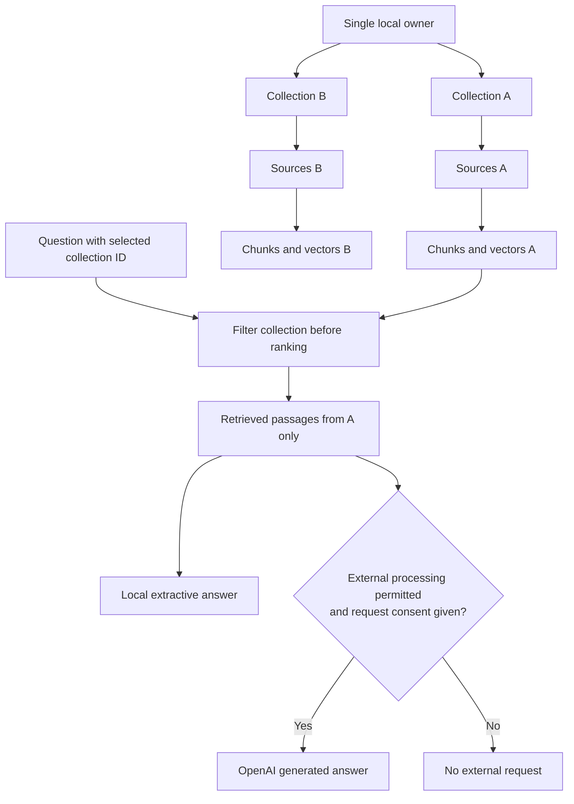

# Local knowledge workspace

The browser interface is served by the API at http://127.0.0.1:8080. Unlock it
using the random value in `.secrets/workspace_token`. The browser receives a
signed HttpOnly, SameSite=Strict session cookie for eight hours; it does not
receive the workspace key or provider key back from the API. The workspace key
is entered locally and is never persisted in browser localStorage.

## Divide knowledge by collection

Start with a small number of coherent topics. Give each source one collection,
and add a brief description of what belongs there. A knowledge chat searches
exactly the selected collection; switching collection clears conversational context.
There is no implicit global search or cross-collection join.



Collections organize context and processing policy; they are not independent
multi-user security domains. The DB role can access all collections. For separate
organizations or stronger operational isolation, run separate stacks with separate
credentials, databases, volumes and backups. The default Compose project name is
fixed: a second deployment requires its own project/ports/configuration rather than
running the same scripts against a different corpus.

## Choose the embedding method once

| Method | Indexing and retrieval | Answer generation |
|---|---|---|
| Local lexical | 128D deterministic hash vectors, no model calls | Retrieved text; optional OpenAI only when collection policy permits |
| OpenAI semantic | `text-embedding-3-small`, 1536D; source text and queries sent to API | Retrieved text or OpenAI, with request consent |

The method, model and dimensions are stored per collection and immutable through
the API. Changing method requires a new collection and reimport. The old synthetic
`/documents` and `/query` example remains in a separate table and is not searched
by the workspace. Local lexical search has no semantic language understanding.

A local-only collection blocks provider-backed retrieval/generation through this
API. This does not prevent an owner from manually copying content elsewhere.
Selecting General chat detaches the collection and clears prior conversation.

## Add sources

The Source library accepts a public HTTPS website, a PDF/TXT/Markdown upload, or
pasted text. Website ingestion is bounded to five same-host pages and respects
robots.txt. It does not discover every page in a site. PDF page numbers and web
page URLs are preserved in passage references. Scanned image-only PDFs need OCR
before upload; EPUB and encrypted PDFs are not supported in this version.
Website imports are snapshots. Automatic refresh/versioning is not implemented;
remove and reimport a source when it changes.

Uploads and extracted text live in PostgreSQL, including the original file payload.
Source deletion cascades through indexed chunks and jobs. Local source manifests,
books and credentials stay under ignored `.private/`, `.local/` or `.secrets/`.
The repository and CI use synthetic examples only. Do not commit real corpora or
export browser sessions/credentials as test fixtures.

## Connect OpenAI

```bash
make configure-openai
```

This prompts for a project key without echoing it and writes the ignored local
secret file. An empty placeholder allows offline startup. Existing credential
updates are read on subsequent requests without exposing them to the frontend.
No key is bundled in an image or checked into the repository. After setup,
`make model-smoke` explicitly performs one real, bounded API request with synthetic
input and records provider token usage. It is not part of offline tests or CI.

Eligible ChatGPT Pro/Business accounts can claim API credits by linking an owned
API organization. Actual eligibility, activation, expiry and balance must be
checked in the account; the app does not infer credit balance from a subscription.
[Official benefit guide](https://developers.openai.com/api/docs/guides/chatgpt-api-credits).

Choose OpenAI in the composer, choose an enabled model, and consent to transmitting
the question, recent conversation and retrieved passages. A collection using
OpenAI embeddings already permits sending its text during indexing; query-time
consent is additionally required for provider-backed retrieval. Documents remain
stored locally, but model processing is external. `store=false` disables Responses
application storage; it does not by itself guarantee zero provider retention.
[Provider data controls](https://developers.openai.com/api/docs/guides/your-data).

Models default to `gpt-6-luna` and `gpt-6.1-sol`; change `OPENAI_CHAT_MODELS` in a
private Compose override for a different account-specific allowlist. Access is not
guaranteed until an actual call succeeds. Requests have a 40-second client timeout,
no SDK retries and a 1,600-token output cap. Knowledge context is limited to five
1,200-character passages; conversation history is limited to eight bounded messages.
These limits are not a monthly spend cap. Provider/project billing settings remain
necessary. The UI reports token counts from provider responses, not estimated credits.

## Operational checks

`make knowledge-test` checks authentication, collection isolation, source deletion,
text upload, worker stop/start recovery and an isolated full knowledge restore.
`make load-test` only checks 20 liveness requests with four concurrent clients;
it makes no capacity or model-throughput claim. Existing backup commands include
the new PostgreSQL tables; the demo archive limit remains 64 MiB.

See the [ingestion runbook](runbooks/KNOWLEDGE-INGESTION.md),
[architecture](ARCHITECTURE.md), [validation](VALIDATION.md) and [roadmap](ROADMAP.md).
