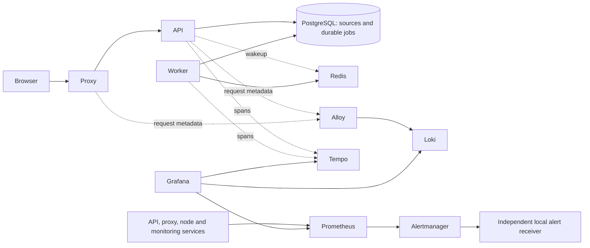

# Observe and troubleshoot the local platform

Use the monitoring attached to the same deployment as your workspace. The VM
profile exposes Grafana at **https://localhost:18443/grafana/**, through the same
private TLS proxy as the application. Read the selected port from
`.local/lab/state.json` if yours differs. Username: `admin`; password:
`.secrets/local-lab/grafana_password`. This is separate from the workspace unlock
key. Review the lab CA as described in [LOCAL-LAB.md](LOCAL-LAB.md).

Open **Dashboards → AI Platform – local operations**. The overview starts with
scrape-target health, failed ingestion counts, HTTP errors and a short diagnostic
path. A green scrape target means its metrics endpoint responds; it does not prove
that an entire user workflow succeeds. Run the synthetic acceptance checks below
for that evidence.

## What each component tells you

| Component | Question it answers | First place to look |
|---|---|---|
| Grafana | Where can I see health, metrics, logs and traces together? | Operations dashboard and Explore |
| Prometheus | Is a target reachable? How many errors, jobs or stale heartbeats? | Health panels; metric queries |
| Loki | What happened at the proxy/API around the failure? | Explore → Loki |
| Alloy | Are request logs reaching Loki? | Its scrape status; a recent known request in Loki |
| Tempo | Which API, queue, worker and database operations belong to one request? | Explore → Tempo; TraceID link from an API log |
| Alertmanager | Did an alert fire and reach the independent lab receiver? | Alerts UI via Prometheus; `.local/lab/alerts/events.jsonl` |
| Node exporter | Is the guest short of memory or disk space? | Guest resource panels |
| PostgreSQL / Redis / worker | Is durable state available and can ingestion progress? | Readiness, container health, worker heartbeat and job states |
| Local registry and signing tools | Is the intended release available and actually running? | `lab-diagnose`: TLS registry check, signature and image comparison |



Terraform, Ansible, registry TLS and signing, and encrypted backup/key escrow form
the deployment/recovery control plane. They are separate from the request path:
a registry failure should not be mistaken for a parser failure in a running app.
The lab diagnostic command includes the active registry services and checks running
image references against the signed release.

## Find an upload failure

1. In the browser developer tools, open **Network**, retry the upload and inspect
   the `POST /api/collections/.../upload` status. Do not copy request bodies,
   cookies, authorization headers or documents into tickets.
2. Open **Grafana → Explore → Loki**, select a time range covering the attempt,
   and run:

   ```logql
   {job="proxy"} | json | DownstreamStatus >= 400
   ```

   Expand the row. `RouterName`, `DownstreamStatus` and `OriginStatus` identify
   whether the proxy rejected the request or received an error from the API.
   A missing/zero `OriginStatus` means no upstream response was received; check
   the proxy error/status before assuming an application or worker failure.
3. Inspect API errors:

   ```logql
   {job="api"} | json | status >= 400
   ```

   The API logs normalized route templates, status, duration and `trace_id`.
   It does not log document content, source names/URLs, questions or credentials.
   Expand a row and click its **TraceID** link to open Tempo.
4. **HTTP 202 means accepted into the queue.** Then check **Source library**:
   `queued → running → ready`, or `failed` with a bounded error code. A parser
   failure can therefore occur after a successful HTTP upload.
5. Follow the trace through `http.request`, `queue.enqueue`, `worker.attempt`,
   `ingestion.attempt`, `ingestion.process` and database/provider spans.
   The job ID connects the enqueue and worker spans; each independent HTTP upload
   starts its own trace unless a caller explicitly supplies remote trace context.
   No raw exception details, SQL parameters or PDF contents are exported.

You can also copy `X-Trace-ID` from an API response and paste it into
**Explore → Tempo → Trace ID**. A request rejected by the proxy before the API
will have no API/worker trace; its proxy log is the relevant starting point.

| Observation | Likely boundary | Next check |
|---|---|---|
| 413, proxy has no upstream response | Proxy size limit/routing | Selected router and configured upload limit |
| 413 with API trace and JSON error | Application file limit | File must be at most 10 MiB |
| 401/403 | Workspace session/origin policy | Unlock and use the configured same-origin URL |
| 502/504 | Proxy cannot reach API / timeout | API state, resource limits and readiness |
| 503 and database probe is zero | Database dependency | Database health and runbook |
| 202, source remains queued | Worker progression | Worker heartbeat, Redis reachability and durable job state |
| Source failed with `PDF_PARSE_FAILED` | PDF parser | Try a valid/text-exported PDF; inspect that job's trace |
| Source failed with `PDF_NEEDS_OCR` | No extractable text | OCR the document locally, then reimport |
| New request absent from Loki | Log collection pipeline | Alloy/Loki health and source log files |
| API log exists, trace absent | Trace export/storage pipeline | Tempo readiness, endpoint configuration and time range |

## Useful metric queries

Use **Explore → Prometheus**:

```promql
up
platform_database_up
platform_worker_heartbeat_age_seconds
platform_jobs
sum by (code, router) (rate(traefik_router_requests_total{code=~"4..|5.."}[5m]))
```

`up` covers API, node exporter, proxy, Alloy, Loki, Tempo, Grafana, Prometheus and
Alertmanager. PostgreSQL and Redis have direct container checks; worker health
uses its heartbeat. Redis failure can make heartbeat monitoring unavailable while
the worker still polls PostgreSQL: Redis is a wakeup optimization, not the durable
queue. Interpret the signals together rather than equating a process with a
successful ingestion.

Proxy access logs deliberately omit paths, query strings, client identity, headers
and bodies. The non-root proxy has a bounded `/tmp` for upload buffering, while
its metadata log file is rotated in the guest every five minutes when over 2 MiB,
with two copies retained. This is a size check every five minutes, not an absolute
instantaneous 2 MiB cap; high-volume log capacity remains to be qualified. Loki and Tempo retain local data for 24 hours; monitoring
volumes stay with this guest. The collector has read-only access to the two log
locations and no Docker socket. Grafana is the only publicly routed monitoring UI;
Loki and Tempo endpoints stay on the guest telemetry network.

## Repeatable operator checks

```bash
make lab-diagnose LAB_VM=recovery
make lab-monitoring-test LAB_VM=recovery
```

The first command is read-only and reports service state, OOM/restart information,
HTTP readiness, Redis ping, aggregate source/error counts, recent sanitized proxy
records, scrape values, datasource readiness, authenticated registry TLS, signature
verification and running-image drift. It stores a private report under
`.local/lab/diagnostics/`. Raw private documents are never included.

The second command creates a clearly named synthetic collection. It uploads valid
PDFs above 64 KiB and 1 MiB, verifies indexed retrieval, exercises both size-limit
boundaries and an invalid PDF, checks independent per-upload traces reaching the
correct worker job, and proves API/proxy logs are queryable through Grafana. A
synthetic content canary must be absent from logs/traces. The intentionally failed
PDF stays visible for learning; remove only that diagnostic source/collection
when finished. These tests never call a model provider or use your real PDF.
The receipt and example trace IDs are in `.local/lab/observability-receipt.json`.

```bash
make lab-monitoring-outage-test LAB_VM=recovery
```

This separate drill briefly stops Tempo, verifies the API and search still work,
and waits for `MonitoringTargetUnavailable` firing and resolved events naming
Tempo in the independent local receiver. It restores Tempo in a `finally` block.
It requires a previous synthetic monitoring run; do not confuse this local delivery
proof with notifying a human or surviving workstation loss.

The ordinary `make lab-check LAB_VM=recovery` also stops/restarts the guest database
to verify readiness, liveness and external firing/resolved alert delivery. Run it
when a brief local database interruption is acceptable. A monitoring configuration
change requires a reload: the deployment playbook restarts the affected monitoring
services after copying bind-mounted configuration. Editing a file alone does not
prove the running process has adopted it.

## Next improvements for operators

Prioritize measurable gaps rather than adding dashboards for unused technology.
First improve the existing operator view with a live service-dependency map,
service purpose/owner, last successful workflow, and direct filtered log/trace links.
Keep the signal and evidence behind every red/green state visible.

1. **External HTTP/TLS probes** with [Blackbox exporter](https://github.com/prometheus/blackbox_exporter):
   validate the user-facing URL, response and certificate expiry outside the app
   guest. An internal scrape can be green while the browser route is broken.
2. **Database/cache diagnostics** with [PostgreSQL exporter](https://github.com/prometheus-community/postgres_exporter)
   and [Redis exporter](https://github.com/oliver006/redis_exporter): expose useful
   connection/lock, memory and latency signals with least-privilege credentials.
   Keep query text, keys and application data out of telemetry.
3. **Container resource evidence** with [cAdvisor](https://github.com/google/cadvisor)
   or a constrained host collector: explain memory pressure, throttling and restarts
   per service. Review host access before adding a collector.
4. **Scheduled synthetic ingestion/search and restore checks**: alert on the last
   successful workflow/restore time, not merely on container uptime. Use dedicated
   synthetic data and preserve a clear cleanup and failure policy.
5. **Actionable alert delivery**: severity, service, user impact, runbook and the
   operator-selected destination. The current independent receiver demonstrates
   delivery on one workstation; it does not page a human or survive its loss.
6. **Trace collection through Alloy**: centralize filtering, buffering and export
   health before adding a second collector. Current API/worker traces go directly
   to Tempo. Consider continuous profiling only when CPU/latency evidence needs it.

These are planned extensions, not installed components or verified capabilities.
See [REQUIREMENTS-AUDIT.md](REQUIREMENTS-AUDIT.md) for the current evidence boundary.

## Extended local checks and alert inbox

The VM has PostgreSQL and Redis exporters and a guest resource sampler. A separate
Blackbox exporter runs on the workstation loopback interface and probes the VM's
workspace, readiness route and Grafana over verified HTTPS. It checks the response
body as well as HTTP status, and exports certificate expiry. This crosses the
VM/router boundary, but still shares the workstation's failure domain.

The operations dashboard also shows connections/locks, Redis memory/ping latency,
container CPU/memory, throttling/OOM counters and the age of the last successful
workflow, backup and restore checks. These are history samples, not continuous
profiling. Missing samples trigger a stale-collector alert. Container counters can
reset when a container is replaced.

The database monitor can inspect PostgreSQL statistics (`pg_monitor`), but cannot
read knowledge tables. SQL-text collectors are disabled. The Redis monitor can
PING and read aggregate INFO statistics, but cannot GET/SCAN keys, read slowlogs
or command logs. Exporters have no published ports. The native guest sampler has
root/Docker access **inside this disposable VM** and publishes aggregate textfile
metrics; application/collector containers receive no Docker socket.

For alerts, open **Grafana → Alerting**, select the **Local alerts** Alertmanager
source, and inspect active alerts and silences. The dashboard's **Local alert
inbox** link opens this area. This is the selected human notification destination;
there is no email, webhook to a third party, or guarantee of notification while
Grafana/the workstation is unavailable. The independent local receiver keeps only
bounded alert names, components, status and timestamps in its private event file.

```promql
probe_success
probe_ssl_earliest_cert_expiry - time()
pg_stat_database_numbackends{datname="platform"}
redis_memory_used_bytes
redis_last_ping_time_seconds
blueprint_container_memory_bytes
rate(blueprint_container_cpu_throttled_periods_total[5m])
blueprint_container_oom_kills_total
blueprint_automation_success
time() - blueprint_automation_last_success
```

```bash
make lab-improvements-test LAB_VM=recovery
```

This check validates every configured scrape target, TLS/response rejection,
restricted exporter access, resource/freshness metrics and Grafana's connection to
Alertmanager. It briefly stops **only the Redis exporter**, checks that the app
stays ready and the alert is visible in the Grafana inbox, then restarts it in a
`finally` block and checks resolution. It does not stop Redis itself.

## Scheduled workflow and recovery checks

```bash
make lab-workflow-check LAB_VM=recovery
make lab-backup LAB_VM=recovery
make lab-restore-check LAB_VM=recovery
make lab-schedule-install LAB_VM=recovery
```

These are project-owned **user** systemd timers: workflow every 15 minutes, backup
at 19:20 and isolated restore at 19:40 in the host's local time. `Persistent=true`
catches missed calendar events when the user manager next runs. No system timer,
user linger, global Docker configuration or host trust store is changed. The user
manager and Docker must be running; this is a workstation exercise, not an
unattended server availability guarantee.

The workflow creates one synthetic collection, uploads a text source, waits for
the real worker, queries offline chat and deletes only that collection's returned
UUID. It never invokes a model provider. Backup and comparison use the **same
exported PostgreSQL snapshot**, so ingestion can continue without invalidating the
comparison. The dump and comparison are encrypted; the old derived plaintext
comparison is retired only after a new authenticated backup succeeds.

The restore check authenticates/downloads the archive and restores it in a fresh,
network-disabled Docker database with bounded RAM/tmpfs. It compares all knowledge
collections, source payload hashes, chunks and vectors. It publishes no ports,
mounts no host data directories and removes only its own temporary container.
It establishes database restore integrity; it does not requalify a fresh VM,
monitoring-volume recovery, UI availability, RPO/RTO or physical offsite recovery.
The local backup key remains necessary and must have independent custody for a
real disaster-recovery claim.

Private job receipts are under `.local/lab/automation/`; Prometheus receives only
fixed check names, numeric success/freshness/duration. A failure retains the
previous successful timestamp. Backup/restore/workflow invocations serialize with
a project-owned lock. Backup retention remains three archives.

To inspect or disable only these schedules (replace the example lab ID with the
`id` from `.local/lab/state.json`):

```bash
systemctl --user list-timers 'ai-blueprint-<id>-*'
systemctl --user status ai-blueprint-<id>-restore.service
systemctl --user disable --now ai-blueprint-<id>-workflow.timer ai-blueprint-<id>-backup.timer ai-blueprint-<id>-restore.timer
```

Do not delete the live VM or its data to repeat the isolated restore check. Do not
paste private receipts, database contents, service credentials or raw dumps into
issues.

## Runtime security gate

```bash
make lab-runtime-audit
make lab-qualified-publish
```

The audit scans each pinned application/monitoring/controller runtime image and
writes vulnerability reports plus CycloneDX SBOMs under ignored local evidence.
HIGH and CRITICAL findings, malformed reports or scanner errors block the gate;
unfixed findings are retained. No ignore list is applied. Report image identity
and scanner exit status must agree. The qualified publication command requires a
fresh full scan **before** any publication, then binds its summary checksum into
the locally signed manifest. A development `lab-publish` remains available and
explicitly marks full runtime security as unqualified.

The API scan alone does not establish runtime security. Some upstream images
still block the full gate; inspect the current summary instead of interpreting a
successful development deployment as a security approval. Source-pinned exporter
build recipes retain their licenses and patch dependencies without exposing key
values or SQL text. Rebuilt images must match the reviewed image lock; a changed
digest requires review and requalification.
