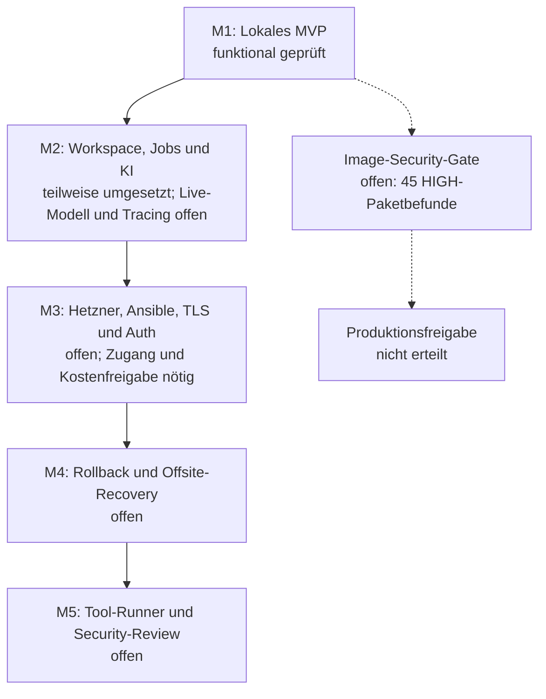

# Roadmap und Abnahme

Ziel: eine kleine, wiederverwendbare Betriebsreferenz für SaaS-/KI-Anwendungen,
mit einer in wenigen Minuten erklärbaren lokalen Demo. Im Repository stehen
synthetische Beispiele; echte Quellen bleiben in privater lokaler Konfiguration.

## Entwicklungsstufen und Nachweise

Die durchgezogenen Pfeile zeigen die vorgeschlagene Umsetzungsreihenfolge,
keinen Zeitplan. Das offene Security-Gate ist eine zusätzliche Freigabegrenze;
ein funktionierendes MVP allein erteilt keine Produktionsfreigabe.

## M1 – ausführbares lokales MVP

Funktional lokal umgesetzt und geprüft. Das Image-Security-Gate bleibt offen;
siehe [Security-Scan](SECURITY-SCAN.md). Keine Produktionsfreigabe.

- Compose startet API, PostgreSQL/pgvector und Traefik mit Healthchecks.
- API bietet Liveness, DB-Readiness, Dokumentaufnahme und belegte Textantworten.
- Offline-Hash-Embeddings ermöglichen reproduzierbare Retrieval-Tests ohne Kosten.
  Das ist ein Retrieval-/extraktiver RAG-Demomodus, kein semantisches LLM-Modell.
- Prometheus sammelt Request-Rate, Fehler, Latenz und DB-Verfügbarkeit.
- Alloy liefert strukturierte API-Request-Logs an Loki. Grafana provisioniert
  Datenquellen und Dashboard. Andere Containerlogs bleiben zunächst in Docker.
- Ein automatisierter DB-Ausfalltest beobachtet 503, einen aktiven Alert und Recovery.
- Verschlüsselter pg_dump wird in einem netzisolierten Einweg-Container restauriert;
  Dokumentinhalte und Vektoren werden gegen den erwarteten Datensatz geprüft.
- CI führt Unit-/Integrationstests, Restore-/Ausfalltest, Dependency-/Image-Scans
  und einen Image-Build aus. Lokale Ergebnisse belegen keinen erfolgreichen CI-Lauf.

Abnahmebefehle und tatsächlich ausgeführte Prüfungen: [VALIDATION.md](VALIDATION.md).
Die folgenden Meilensteine sind offen; die ursprünglichen elf Häkchen sind kein Nachweis.

## M2 – Knowledge Workspace und KI-Integration (teilweise umgesetzt)

Implementiert: Frontend, Owner-Session, Collections mit Scope vor dem Ranking,
Website-/PDF-/Text-Ingestion, PostgreSQL-Jobqueue mit Redis-Wakeup, Worker-Leases,
Retries/Timeout, optionale OpenAI Responses/Embeddings, Quellenansicht und
Provider-Tokenzählung. Lokale synthetische Tests benötigen keinen echten API-Key.
Eine echte Modellantwort und account-spezifische Credits sind erst nach lokaler
Schlüsselkonfiguration live prüfbar. Tempo/Tracing bleiben offen.

Die folgenden ursprünglichen M2-Anforderungen bleiben Ziel bzw. Nachweisgrenze:

Redis + separater Worker: idempotente Ingestion, begrenzte Retries mit Backoff,
Dead Letter Queue, Queue-Tiefe, Alter des ältesten Jobs und Worker-Ausfalltest.
Provider-Adapter für echte Embeddings/LLM mit Timeout, begrenztem Kontext,
Tokenzählung aus Providerantworten und versionierten Preisannahmen. Gemessene
und geschätzte Kosten getrennt ausweisen. OpenTelemetry + Tempo für API-,
DB-, Queue- und Provider-Spans; keine Dokumente/Prompts in Telemetrie.
Abnahme: Retry-/Duplikat-/Timeout-Tests und Trace einer vollständigen Anfrage.

## M3 – einzelner Hetzner-Server (offen)

Terraform für Server, Firewall und Volumes; Ansible für SSH-Benutzer,
Paketupdates, Docker, Firewall und Konfiguration. Remote-State und Secrets
festlegen, bevor Infrastruktur angelegt wird. TLS, Authentifizierung,
Rate-Limits und externe Alert-Zustellung ergänzen. Betriebssystemmetriken,
Ressourcenbudgets, Datenaufbewahrung und Plattenwarnungen ergänzen.
Abnahme: Neuaufbau auf einem freigegebenen Testserver, HTTP-Abweisung,
TLS-/Auth-Prüfung, externer Alert. Benötigt Owner-Zugang und Kostenfreigabe.

## M4 – Deployment und Disaster Recovery (offen)

Images per Digest referenzieren, Herkunft/Signaturen prüfen. Migrationsverfahren
und kompatible Rollbacks testen; Wartungsfenster zunächst zulässig. Keine
Zero-Downtime-Zusage für einen einzelnen Compose-Host. Restic oder pgBackRest
für versionierte Offsite-Backups, separate Schlüsselverwahrung und Retention.
Abnahme: vorherige Version mit Datenkompatibilität wiederherstellen sowie
Restore auf frischem Host; gemessene RPO/RTO und Verantwortlichkeiten festhalten.
Das lokale Fernet-Backup ist eine kleine Demonstration, keine Offsite-Strategie.

## M5 – isolierter Tool-Runner und Security-Evidence (offen)

Separate Ausführungsgrenze ohne Docker-Socket, explizite Netzwerk-/Tool-Allowlist,
CPU-/RAM-/Zeitlimits, read-only Filesystem, kein Zugriff auf App-Secrets.
Hostile-input-/Escape-Tests; Container allein nicht als sichere Grenze für
beliebigen fremden Code ausgeben. Auditberichte mit Scope, Datum, Findings,
Restrestrisiken und nachvollziehbaren Belegen. Abnahme durch unabhängiges Review.
