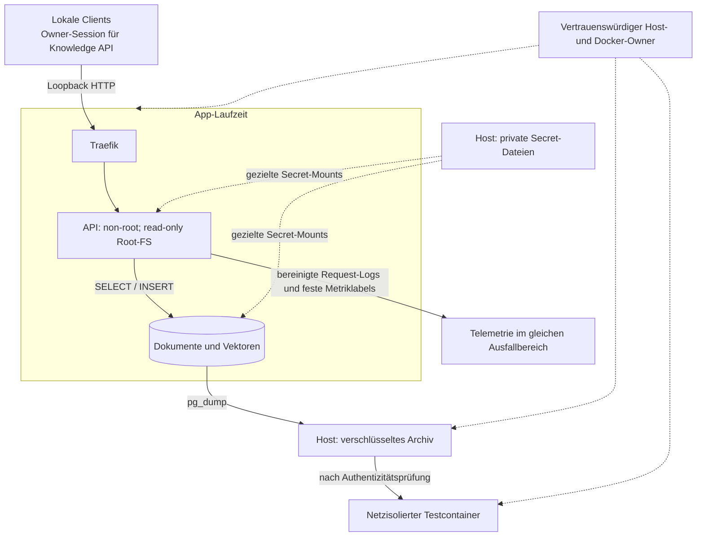

# Threat Model – lokales MVP

Schützenswert: Dokumente, DB-Zugang, Backup-Schlüssel und Archive. Vertrauensgrenze:
Loopback-Client → Proxy → API → DB; Telemetrie und Backups sind weitere Datensenken.
Die Legacy-Demo bleibt synthetisch und unautorisierte lokale Clients können deren
separate Beispieltabelle lesen/beschreiben. Neue Knowledge-Endpunkte erfordern
eine signierte Owner-Session. Loopback ersetzt keine Mehrbenutzer-Isolation.

## Vertrauens- und Datengrenzen

Durchgezogene Pfeile zeigen Daten- oder Request-Flüsse; gestrichelte Pfeile
zeigen Credential- oder Kontrollzugriff. Der Docker-Owner bleibt vertrauenswürdig.
Loopback ist eine Netzwerkbegrenzung und ersetzt keine Benutzerberechtigung.

## Risiken und Maßnahmen

| Risiko | MVP-Maßnahme | Verbleibende Grenze |
|---|---|---|
| SQL-Injection | parametrisierte SQL-Werte | kein unabhängiges Penetrationstestat |
| Ressourcenmissbrauch | Textlängen, Trefferlimit, DB-Timeout, Containerlimits, Proxy-Bodylimit | keine Benutzerquoten/Rate-Limits |
| Secret-Verlust | zufällige Dateien in 0700-Verzeichnis, Backup-Key 0600, Git-ignore, Compose-Secrets | Host/Daemon-Owner kann sie lesen |
| Telemetrie-Abfluss | feste Routenlabels; keine Bodies, Querystrings oder DB-Fehlerdetails | Request-Zeiten bleiben sichtbar |
| Hostübernahme | kein Docker-Socket in Containern, non-root API, Cap-Drop | Container sind kein gehärteter Tool-Sandbox-Ersatz |
| Backup-Manipulation | Fernet authentifiziert; falscher Schlüssel/Tampering scheitert vor Restore | Schlüsselverlust vernichtet Wiederherstellbarkeit |
| Datenverlust bei Restore-Test | network none, tmpfs, kein App-Volume, temporärer Container | lokaler Docker-Daemon bleibt vertrauenswürdig |
| Supply Chain | Lockfile, feste Tags, CI-Scans | keine signierten Digest-Pins; Scan ist keine Sicherheitsgarantie |

Vor öffentlichem Betrieb sind TLS, AuthN/AuthZ, Firewall, Secret-Rotation,
Offsite-Backups, externe Alerts und ein aktueller Security-Review erforderlich.

Lokales Compose mountet Secrets ohne UID-Remapping: DB-/Grafana-Passwortdateien
sind 0644 innerhalb des geschützten 0700-Verzeichnisses, damit die non-root
Container sie lesen können. Der Backup-Key bleibt 0600 und wird nie gemountet.

## Neue Knowledge-Grenzen

- Alle `/api/`-Knowledge-Routen benötigen eine Owner-Session; Login prüft eine
  zufällige lokale Workspace-Datei, Cookie ist HttpOnly und SameSite=Strict.
  Schreibende Requests mit fremder Origin werden abgewiesen. Kein OAuth/RBAC/RLS.
- Collection-ID wird vor der Vektorsuche gefiltert. Embedding-Methode und
  Dimensionen sind unveränderlich; Kontext wird beim Collection-Wechsel geleert.
- Websites erfordern öffentliches HTTPS. DNS-Antworten werden auf globale IPs
  geprüft und der geprüfte Zielhost wird für die TLS-Verbindung gepinnt. Jeder
  Redirect wird erneut geprüft. Keine Cloud-Metadaten-/Loopback-/privaten Ziele.
- Uploads werden nicht als Code ausgeführt. Parsing läuft in einem separaten
  Worker-Kindprozess mit Zeitlimit, Container-Ressourcenlimits und begrenzter
  Eingabegröße. Das ist kein sicherer Runner für beliebigen fremden Code.
- Frontend nutzt textContent für Antworten und Quellentitel, keine HTML-Ausführung.
  Browser-Assets kommen lokal; CSP begrenzt Scripts und Requests auf die eigene Origin.
- Provider-Key bleibt serverseitig in einer ignorierten lokalen Datei. Externe
  Embeddings übertragen Quelltext; Modellantworten übertragen ausgewählte
  Passagen und die Frage. Policy und Consent gelten vor dem Aufruf.
- Local-only ist eine App-Policy und kein DLP-Schutz gegen manuelles Kopieren.
  Source-Löschung löscht weder frühere Backups noch bereits extern übertragene Daten.
