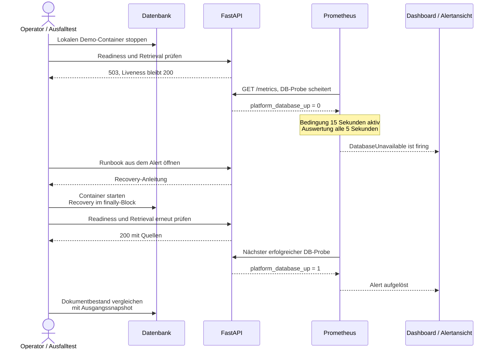

# DatabaseUnavailable

Symptom: Readiness und Retrieval liefern 503, Liveness bleibt 200;
`platform_database_up` ist 0. Prometheus zeigt den Alert nach 15 Sekunden.

## Beobachtung und Recovery

Der Alert wird im nächsten Auswertungszyklus nach erfüllter Haltezeit aktiv.
Es gibt keine externe Zustellung. Die Test-Recovery startet dieselbe Datenbank
mit ihrem bestehenden Volume; ein Backup-Restore ist ein separates Szenario.

## Schritte

1. `make status` und `make logs` ausführen. DB-Containerstatus, Platte und Logs
   prüfen. Keine Volumes löschen und keine Zugangsdaten in Tickets kopieren.
2. Beim absichtlichen Demo-Ausfall: `./scripts/compose.sh start db` ausführen.
   Bei realem Datenverlust zuerst Ursache sichern und DR-Plan heranziehen.
3. Readiness und Abfrage prüfen: `make smoke`. Alert muss nach der nächsten
   Auswertung verschwinden. Grafana zeigt Fehler und Latenz; Loki zeigt Statuscodes.
4. `make failure-test` automatisiert Stop, 503-/Alert-Prüfung und Start mit
   Wiederherstellung im finally-Block. Nur im lokalen Demo-Projekt ausführen.

Dashboard: http://127.0.0.1:3000/d/platform-overview
Alertstatus: http://127.0.0.1:9090/alerts
Das MVP verschickt keine Benachrichtigungen an externe Empfänger.
