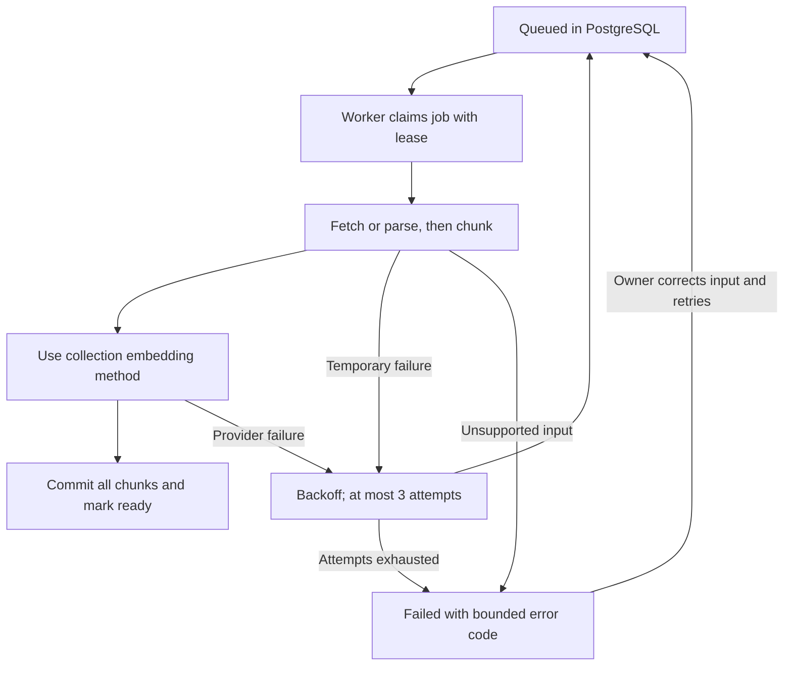

# Knowledge ingestion

The source library shows each source as queued, running, ready or failed. Sources
are visible only after a complete index has been committed. Partial chunks never
replace a completed index. The application is a single-owner local workspace.

1. Inspect `make status` and `./scripts/compose.sh logs --tail=50 worker`.
2. `queued`: start the worker with `./scripts/compose.sh start worker`. Redis is
   a wakeup optimization; PostgreSQL owns the durable job. Redis loss does not
   discard committed jobs. A killed running job becomes reclaimable after its
   240-second lease; child processing is limited to 180 seconds per attempt.
3. `PDF_NEEDS_OCR`: perform OCR locally before uploading. Encrypted PDFs and PDFs
   over 400 pages are rejected. Use PDF/TXT/Markdown up to 10 MiB; extracted text
   is limited to two million characters and 2,000 overlapping chunks per source.
4. `NON_PUBLIC_TARGET_BLOCKED` or `CROSS_HOST_REDIRECT_BLOCKED`: do not bypass the
   URL checks. Only public HTTPS targets are fetched, DNS is pinned, redirects
   are checked individually, and the initial canonical www redirect is permitted.
5. `ROBOTS_DISALLOWED`: respect the source's crawl restrictions. The importer
   visits at most five pages on the same host; it is not a complete site archive.
6. `PROVIDER_UNAVAILABLE`: check local key configuration, API project credits and
   model access. Do not paste keys into tickets. After correction, use Retry in
   the source library. Automatic retries can consume additional provider tokens.
7. Deleting a source removes its original payload, chunks and job by cascade.
   A running ingestion checks source existence before committing. Deletion does
   not erase previous encrypted backups or data already sent to a provider.

Source content, URLs, keys and questions must never be added to application logs.
The worker heartbeat is observable via `/metrics`; the alert does not send any
external notification. A long-running job may defer the heartbeat up to its timeout.
