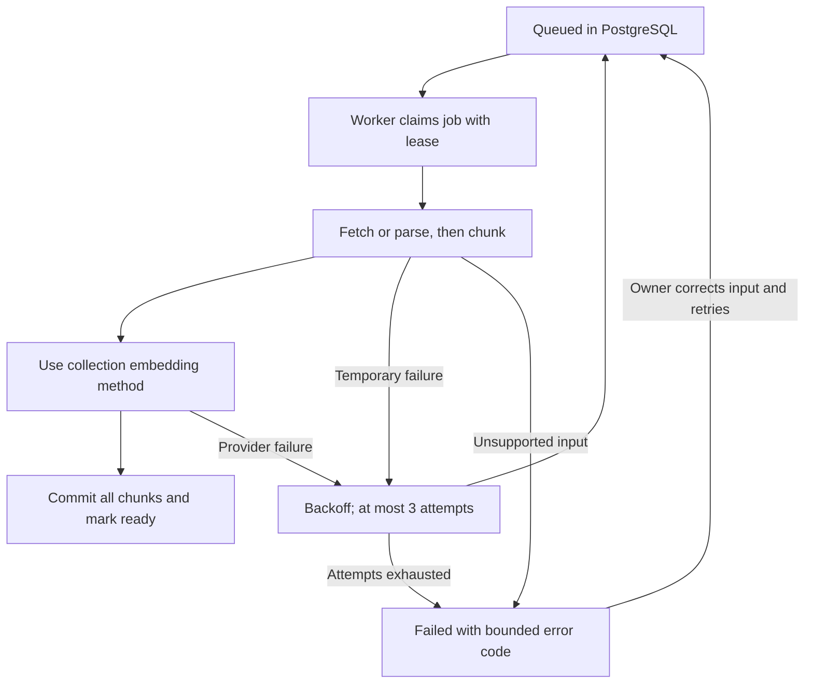

# Knowledge ingestion

The source library shows each source as queued, running, ready or failed. Sources
are visible only after a complete index has been committed. Partial chunks never
replace a completed index. The application is a single-owner local workspace.



For the local VM deployment, use `make lab-diagnose LAB_VM=recovery` and
[Grafana/Loki/Tempo troubleshooting](../LOCAL-OBSERVABILITY.md). The workstation
Compose commands below inspect only that separate deployment.

An upload rejected before HTTP 202 has not reached worker processing. Check the
browser's Network status and the proxy log first. HTTP 413 can be a proxy routing/
size-limit rejection; a successful HTTP 202 still requires a later `ready` state.

1. Inspect `make status` and `./scripts/compose.sh logs --tail=50 worker`.
2. `queued`: start the worker with `./scripts/compose.sh start worker`. Redis is
   a wakeup optimization; PostgreSQL owns the durable job. Redis loss does not
   discard committed jobs. A killed running job becomes reclaimable after its
   240-second lease; child processing is limited to 180 seconds per attempt.
3. `PDF_NEEDS_OCR`: perform OCR locally before uploading. Encrypted PDFs and PDFs
   over 400 pages are rejected. Use PDF/TXT/Markdown up to 10 MiB; extracted text
   is limited to two million characters and 2,000 overlapping chunks per source.
4. `NON_PUBLIC_TARGET_BLOCKED` or `CROSS_HOST_REDIRECT_BLOCKED`: do not bypass the
   URL checks. Only public HTTPS targets are fetched, DNS is pinned, redirects
   are checked individually, and the initial canonical www redirect is permitted.
5. `ROBOTS_DISALLOWED`: respect the source's crawl restrictions. The importer
   visits at most five pages on the same host; it is not a complete site archive.
6. `PROVIDER_UNAVAILABLE`: check local key configuration, API project credits and
   model access. Do not paste keys into tickets. After correction, use Retry in
   the source library. Automatic retries can consume additional provider tokens.
7. Deleting a source removes its original payload, chunks and job by cascade.
   A running ingestion checks source existence and attempt ownership before
   committing. Deletion does
   not erase previous encrypted backups or data already sent to a provider.

Source content, URLs, keys and questions must never be added to application logs.
The worker heartbeat is observable via `/metrics`. Alert delivery depends on the
profile: the VM routes selected alerts to its separate local receiver; it does not
page a human. A long-running job may defer the heartbeat up to its timeout.

## Attempt ownership and crash qualification

Every claim receives a fresh UUID token. Final index writes and failure/retry
updates require that token, running status and an unexpired lease. Writers acquire
source and job locks in that order, matching deletion and manual retry. An expired
or reclaimed attempt cannot change the active index or fail/requeue a newer job.
A manual retry resets the attempt count and invalidates the previous owner.
Redis client retries are explicitly disabled for wakeups/heartbeat operations;
durable job retries remain in PostgreSQL. Redis failure therefore does not invoke
the library's exponential retry loop before falling back to database polling.

Migration `003-job-ownership-tracing.sql` is additive. The deployment script stops
the old worker and its children before applying migrations and starting the new
application. A job interrupted by that stop remains reclaimable after lease expiry;
the database volume is preserved. Do not run older workers alongside this version.

```bash
make queue-test
```

This runs in a separate temporary database and exercises real child termination
after claim, during processing, before commit and after commit. It also checks
stale success/failure, expiry before reclamation, retry exhaustion, manual retry,
non-retryable child errors, provider failures with backoff, deletion during work,
Redis unavailability and skipping a source locked by another transaction.
The timeout handler is tested with an injected `TimeoutExpired`; the suite does
not wait 180 seconds to qualify the operating system's wall-clock timeout behavior.
No fault-injection hooks are installed in production code.

Database idempotency does not guarantee exactly-once provider billing: retries
can repeat embedding calls. For cross-process diagnosis, see the optional
[tracing guide](../../observability/tempo/README.md). Default CI runs the disposable
queue and tracing checks without accessing the workspace's sources or secrets.
